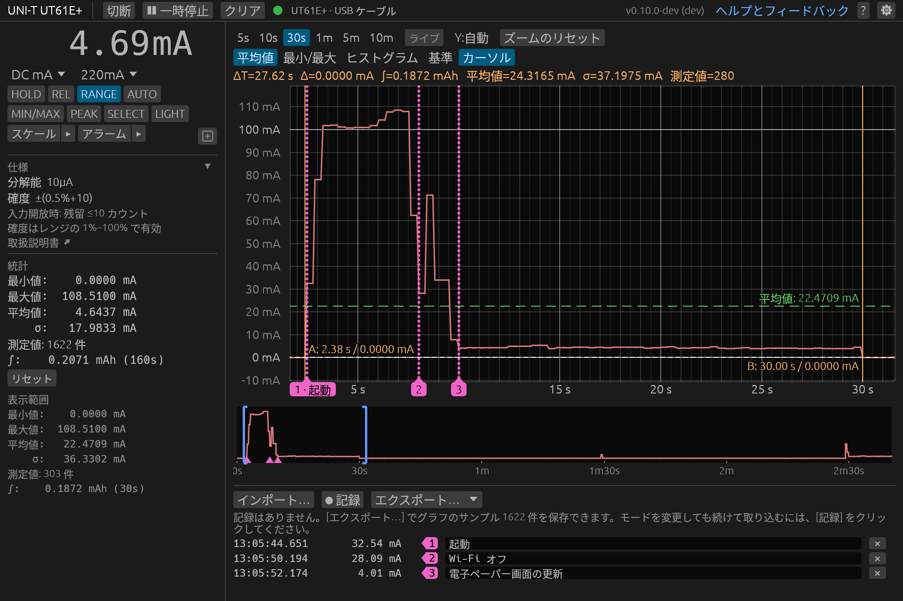

<!-- translated from README.md b3f3a0a3722dd935b8bf521ad26efad3a0c63a18 -->
# dmm-tools

[](https://github.com/antoinecellerier/dmm-tools/actions/workflows/ci.yml)
[](https://github.com/antoinecellerier/dmm-tools/releases/latest)
[](LICENSE)

[English](README.md) · [Español](README.es.md) · [Français](README.fr.md) · [Português (Brasil)](README.pt-BR.md) · **日本語** · [简体中文](README.zh-CN.md)

*このページは自動翻訳です。基準となるのは[英語版の README](README.md) です。日本語を母語とする方のレビューを歓迎します ([翻訳への協力](CONTRIBUTING.md#translations)、英語)。*

dmm-tools は、UNI-T、ZOTEK (ZOYI、ANENG、BSIDE)、OWON、Brymen (Minipa)、EEVblog、Voltcraft のデジタル マルチメーター (DMM) とクランプ メーターに USB または Bluetooth で接続し、測定値の読み取り、記録、グラフ表示、メーターのリモート操作を行うオープンソースのデスクトップ アプリとコマンド ライン ツールです。Linux、Windows、macOS、Raspberry Pi で動作します。

UNI-T UT61E+、UT181A、UT161、UT71、UT60BT、UT804、ANENG AN9002 (ZOTEK ZT-300AB)、Brymen BM869s、EEVblog 121GW、OWON OW18E と B41T+、Voltcraft VC-890 をはじめ、[さまざまな機種](#対応機種)に対応しています。

**目次:** [機能](#機能) · [対応機種](#対応機種) · [クイック スタート](#クイック-スタート) · [ドキュメント](#ドキュメント) · [フィードバック](#フィードバック) · [ライセンス](#ライセンス)



## 機能

デスクトップ アプリとコマンド ライン ツールの両方に、次の機能があります:

- 接続されているマルチメーターの検出
- マルチメーターのリモート操作: モードとレンジの切り替え、ボタンの操作
- CSV、JSON、リプレイ ファイルへの測定値の保存と読み込み
- 統計の計算: 最小値、最大値、平均値、標準偏差、時間積分
- 測定値が上限を超えるか下限を下回ったときのアラーム
- ソフトウェアでの測定値のスケーリング、オフセット、単位ラベルの変更
- 英語、スペイン語、中国語 (簡体字)、日本語、フランス語、ポルトガル語 (ブラジル) での表示 (システムの言語に従う)

### デスクトップ アプリ (`dmm-gui`)

デスクトップ アプリには、さらに次の機能があります:

- 現在の測定値と、そのレンジの分解能と確度 (マニュアル記載値) の表示
- カーソル、基準線、最小/最大エンベロープ、ヒストグラムを備えた、測定値のライブ グラフ
- 長時間のセッションの記録と、任意の測定値へのマーカーとメモの追加
- 測定値をウィンドウいっぱいに表示する大型表示モード

[GUI ヘルプ](docs/gui-reference.md) (英語) では、デスクトップ アプリの使い方を詳しく説明しています。

### コマンド ライン ツール (`dmm-cli`)

コマンド ライン ツールには、さらに次の機能があります:

- 端末、ファイル、ほかのプログラムへの測定値のストリーミング (テキスト、CSV、JSON 形式)
- スクリプトからマルチメーターのモード、レンジ、フラグを名前で一覧表示・設定する機能
- バグ報告や新しい機種の検証のためのガイド付きキャプチャ

<!-- snippet via=dcma-boot-refresh.replay
dmm-cli read --interval-ms 2500 --count 5
-->
```
$ dmm-cli read --interval-ms 2500 --count 5
0.00 mA
32.54 mA
100.96 mA
107.95 mA
4.01 mA

--- 測定値 5 件 | 最小値: 0.00 mA | 最大値: 107.95 mA | 平均値: 49.09 mA | σ: 52.13 mA
```
<!-- /snippet -->

[CLI ヘルプ](docs/cli-reference.md) (英語) では、コマンド ライン ツールの使い方を詳しく説明しています。

## 対応機種

| 機種 | USB | Bluetooth | Issue |
|---|---|---|---|
| UNI-T UT61E+ | ✅ 検証済み | ✅ 検証済み (アダプター) | — |
| UNI-T UT61B+ | ✅ 検証済み | 🧪 試験的 (アダプター) | [#19](https://github.com/antoinecellerier/dmm-tools/issues/19) |
| UNI-T UT161E | ✅ 検証済み | 🧪 試験的 (アダプター) | [#7](https://github.com/antoinecellerier/dmm-tools/issues/7) |
| UNI-T UT61D+, UT161B/D | 🧪 試験的 | 🧪 試験的 (アダプター) | [#7](https://github.com/antoinecellerier/dmm-tools/issues/7) |
| UNI-T UT804 | ✅ 検証済み | — | [#16](https://github.com/antoinecellerier/dmm-tools/issues/16) |
| UNI-T UT803 | 🧪 試験的 | — | [#15](https://github.com/antoinecellerier/dmm-tools/issues/15) |
| UNI-T UT181A | 🟡 一部検証済み | 🧪 試験的 (アダプター) | [#5](https://github.com/antoinecellerier/dmm-tools/issues/5) |
| UNI-T UT171A/B/C | 🧪 試験的 | 🧪 試験的 (アダプター) | [#4](https://github.com/antoinecellerier/dmm-tools/issues/4) |
| UNI-T UT60BT | — | 🧪 試験的 (内蔵) | [#26](https://github.com/antoinecellerier/dmm-tools/issues/26) |
| UNI-T UT202BT | — | 🧪 試験的 (内蔵) | [#27](https://github.com/antoinecellerier/dmm-tools/issues/27) |
| UNI-T UT71A/B, UT71C/D/E | 🧪 試験的 | 🧪 試験的 (アダプター) | [#22](https://github.com/antoinecellerier/dmm-tools/issues/22) |
| UNI-T UT8802, UT8802N | 🧪 試験的 | — | [#12](https://github.com/antoinecellerier/dmm-tools/issues/12) |
| UNI-T UT8803, UT8803E | 🧪 試験的 | — | [#3](https://github.com/antoinecellerier/dmm-tools/issues/3) |
| OWON CMS061 (UNI-T UT217A) | — | ✅ 検証済み (内蔵) | [#45](https://github.com/antoinecellerier/dmm-tools/issues/45) |
| OWON B33 | — | 🧪 試験的 (内蔵) | [#41](https://github.com/antoinecellerier/dmm-tools/issues/41) |
| OWON B35T+ | — | 🧪 試験的 (内蔵) | [#42](https://github.com/antoinecellerier/dmm-tools/issues/42) |
| OWON B41T+ | — | 🧪 試験的 (内蔵) | [#43](https://github.com/antoinecellerier/dmm-tools/issues/43) |
| OWON CM2100B | — | 🧪 試験的 (内蔵) | [#44](https://github.com/antoinecellerier/dmm-tools/issues/44) |
| OWON CMS101 (UNI-T UT217B) | — | 🧪 試験的 (内蔵) | [#45](https://github.com/antoinecellerier/dmm-tools/issues/45) |
| OWON OW18B/OW16B | — | 🧪 試験的 (内蔵) | [#39](https://github.com/antoinecellerier/dmm-tools/issues/39) |
| OWON OW18E | — | 🧪 試験的 (内蔵) | [#40](https://github.com/antoinecellerier/dmm-tools/issues/40) |
| OWON OW65B | — | 🧪 試験的 (内蔵) | [#46](https://github.com/antoinecellerier/dmm-tools/issues/46) |
| OWON OW67B (Voltcraft VC871) | — | 🧪 試験的 (内蔵) | [#47](https://github.com/antoinecellerier/dmm-tools/issues/47) |
| OWON OW69B (Voltcraft VC891) | — | 🧪 試験的 (内蔵) | [#48](https://github.com/antoinecellerier/dmm-tools/issues/48) |
| ZOTEK ZT-5B (ANENG V05B) | — | ✅ 検証済み (内蔵) | [#31](https://github.com/antoinecellerier/dmm-tools/issues/31) |
| ZOTEK ZT-5BQ (ANENG ST207) | — | 🧪 試験的 (内蔵) | [#30](https://github.com/antoinecellerier/dmm-tools/issues/30) |
| ZOTEK ZT-300AB (ANENG AN9002) | — | 🧪 試験的 (内蔵) | [#28](https://github.com/antoinecellerier/dmm-tools/issues/28) |
| ZOTEK ZT-5566SE (ANENG AN999S) | — | 🧪 試験的 (内蔵) | [#29](https://github.com/antoinecellerier/dmm-tools/issues/29) |
| Brymen BM525s (Minipa ET-2615A) | 🟡 一部検証済み | — | [#36](https://github.com/antoinecellerier/dmm-tools/issues/36) |
| Brymen BM827s (Minipa ET-2517A) | 🟡 一部検証済み | — | [#35](https://github.com/antoinecellerier/dmm-tools/issues/35) |
| Brymen BM521s | 🧪 試験的 | — | [#36](https://github.com/antoinecellerier/dmm-tools/issues/36) |
| Brymen BM829s/BM822s/BM821s | 🧪 試験的 | — | [#35](https://github.com/antoinecellerier/dmm-tools/issues/35) |
| Brymen BM869s/BM867s | 🧪 試験的 | — | [#34](https://github.com/antoinecellerier/dmm-tools/issues/34) |
| Brymen BM788BT/BM787BT | — | 🧪 試験的 (内蔵) | [#33](https://github.com/antoinecellerier/dmm-tools/issues/33) |
| EEVblog 121GW | — | 🧪 試験的 (内蔵) | [#32](https://github.com/antoinecellerier/dmm-tools/issues/32) |
| Voltcraft VC-880, VC650BT | 🧪 試験的 | — | [#13](https://github.com/antoinecellerier/dmm-tools/issues/13) |
| Voltcraft VC-890 | 🧪 試験的 | — | [#14](https://github.com/antoinecellerier/dmm-tools/issues/14) |
| Voltcraft VC915/VC925 PV | — | 🧪 試験的 (内蔵) | [#49](https://github.com/antoinecellerier/dmm-tools/issues/49) |
| Voltcraft VC920/VC940/VC960 | 🧪 試験的 | — | [#23](https://github.com/antoinecellerier/dmm-tools/issues/23) |

✅ = 実機でモードとコマンドを確認済み (一部の確認項目を除く)。🟡 = 接続と主なモードを確認済み。検証されていないモードやコマンドが残っています。🧪 = メーカーのソフトウェアからリバース エンジニアリングしたもので、その接続方法での実機テストはまだ行われていません。— = その接続方法には対応していません。

Bluetooth の「アダプター」は UNI-T のオプション品 UT-D07A/B です。「内蔵」の機種にはアダプターは不要です。動いた機能、動かなかった機能を、その機種の Issue でお知らせください。

ケーブル、Bluetooth アダプター、メーター側でオンにする設定、各機種で確認済みの内容については、[対応機種の一覧](docs/supported-devices.md) (英語) をご覧ください。お使いのマルチメーターが一覧にない場合は、機種名と接続方法を添えて [Issue を作成](https://github.com/antoinecellerier/dmm-tools/issues/new)してください。

## クイック スタート

1. お使いのプラットフォーム向けの[最新リリース](https://github.com/antoinecellerier/dmm-tools/releases/latest)をダウンロードして展開します。初回起動時、[Windows](docs/setup.md#windows-protected-your-pc) と [macOS](docs/setup.md#macos-wont-open-dmm-cli-or-dmm-gui) ではセキュリティ警告が表示されます (リンク先は英語)。
2. ツールにケーブルへのアクセスを許可するか、Bluetooth をオンにします:
   - Linux: udev ルールをインストールしてから、ケーブルを接続し直します。
     ```sh
     sudo cp udev/70-dmm-tools.rules /etc/udev/rules.d/ && sudo udevadm control --reload-rules
     ```
   - Windows: CP2110 ケーブルには [Silicon Labs のドライバー](https://www.silabs.com/developers/usb-to-uart-bridge-vcp-drivers)が必要な場合があります。ほかのケーブルはそのまま使えます。
   - macOS: インストールするものはありません。
3. マルチメーターのデータ転送をオンにして、次を実行します:
   ```sh
   dmm-cli read            # 測定値をストリーミングする
   dmm-gui                 # GUI を起動する
   ```

[セットアップとトラブルシューティング](docs/setup.md) (英語) では、ドライバー、udev の詳細、ディスプレイのないマシン、ソースからのビルド、開発版ビルドについて説明しています。

## ドキュメント

ユーザー向け:

- [CLI リファレンス](docs/cli-reference.md) (英語)
- [GUI リファレンス](docs/gui-reference.md) (英語)
- [セットアップとトラブルシューティング](docs/setup.md) (英語)
- [対応機種の一覧](docs/supported-devices.md) (英語)
- [変更履歴](CHANGELOG.md) (英語)

コントリビューター向け: バグ報告、プロトコル キャプチャ、コードの変更については [CONTRIBUTING.md](CONTRIBUTING.md) をご覧ください。ほかに[開発ガイド](docs/development.md)、[アーキテクチャ](docs/architecture.md)、[プロトコルの詳細](docs/protocol.md)、[UX デザイン](docs/ux-design.md)、[デバイスの追加](docs/adding-devices.md)があります (いずれも英語)。

## フィードバック

バグ、アイデア、質問、アプリやドキュメントでわかりにくかった点などは、[Issue を作成](https://github.com/antoinecellerier/dmm-tools/issues/new)してお知らせください。[機種の表](#対応機種)にあるマルチメーターの動作状況は、その行の Issue に書き込んでください。[バグ報告に含める内容](CONTRIBUTING.md#bug-reports) (英語) もご覧ください。

## ライセンス

GPL-3.0-or-later。詳しくは [LICENSE](LICENSE) をご覧ください。

## 謝辞

参考や照合に使った次のコミュニティ プロジェクトに感謝します:

- [ljakob/unit_ut61eplus](https://github.com/ljakob/unit_ut61eplus) と [mwuertinger/ut61ep](https://github.com/mwuertinger/ut61ep): UT61E+ プロトコル (Python と Go)
- [gulux/Uni-T-CP2110](https://github.com/gulux/Uni-T-CP2110): UT171 のキャプチャとパーサー
- [antage/ut181a](https://github.com/antage/ut181a) と [libsigrok `uni-t-ut181a`](https://github.com/sigrokproject/libsigrok/tree/master/src/hardware/uni-t-ut181a): UT181A プロトコル
- [pylablib](https://github.com/AlexShkarin/pyLabLib): VC-880 のテーブルとフラグ
- [Silicon Labs AN434](https://www.silabs.com/documents/public/application-notes/an434-cp2110-4-interface-specification.pdf): CP2110 の HID-UART 仕様。[UNI-T](https://meters.uni-trend.com/download/ut61b-d-e-user-manual/): UT61+ のユーザー マニュアル
