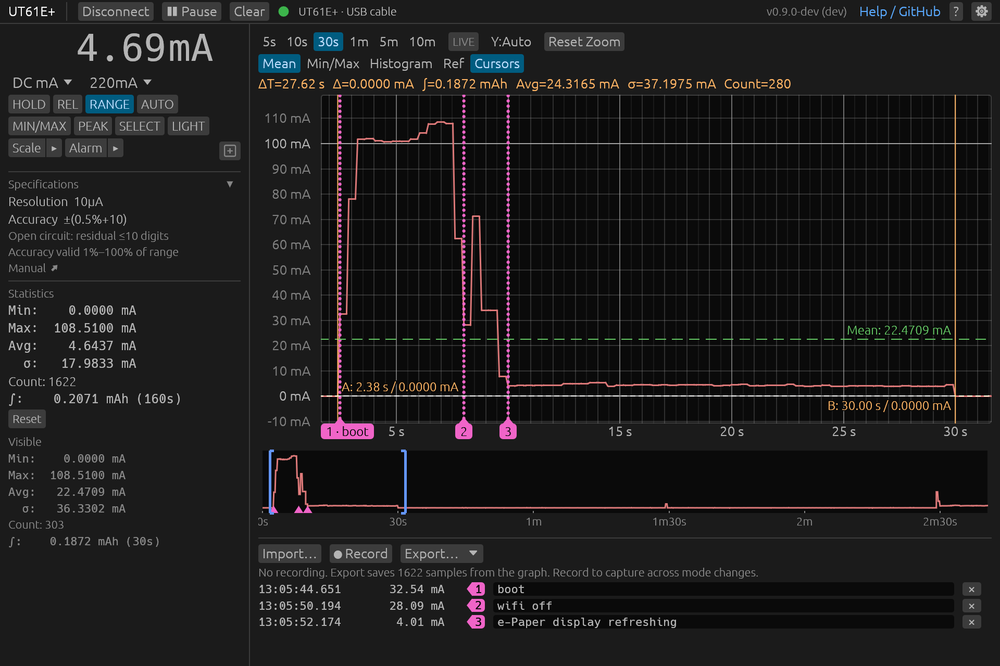

# dmm-tools

[](https://github.com/antoinecellerier/dmm-tools/actions/workflows/ci.yml)
[](https://github.com/antoinecellerier/dmm-tools/releases/latest)
[](LICENSE)

Open-source desktop app and command-line tool to read, log, graph and remote-control digital multimeters (DMMs) and clamp meters from UNI-T, ZOTEK (ZOYI, ANENG, BSIDE), OWON, Brymen (Minipa), EEVblog and Voltcraft, over USB and Bluetooth, on Linux, Windows, macOS and Raspberry Pi.

Works with the UNI-T UT61E+, UT181A, UT161, UT71, UT60BT and UT804, ANENG AN9002 (ZOTEK ZT-300AB), Brymen BM869s, EEVblog 121GW, OWON OW18E and B41T+, Voltcraft VC-890 and [more](#supported-devices).

**Contents:** [Features](#features) · [Supported devices](#supported-devices) · [Quick start](#quick-start) · [Documentation](#documentation) · [Feedback](#feedback) · [License](#license)



## Features

Both the desktop app and the command-line tool:

- Detect which meter is connected
- Remote-control the meter: switch mode and range, press its buttons
- Save readings as CSV, JSON or a replay file, and open them again
- Keep statistics: min, max, average, standard deviation and the integral over time
- Raise an alarm when a reading crosses a limit
- Scale, offset and relabel readings in software

### Desktop app (`dmm-gui`)

The desktop app also:

- Shows the live reading with the range's resolution and accuracy from the manual
- Graphs readings live, with cursors, reference lines, a min/max envelope and a histogram
- Records long sessions, with markers and notes on any reading
- Fills the window with the reading in big meter mode

[GUI help](docs/gui-reference.md): the full guide to the desktop app.

### Command-line tool (`dmm-cli`)

The command-line tool also:

- Streams readings as text, CSV or JSON to the terminal, a file or another program
- Lists and sets the meter's mode, range and flags by name, for scripts
- Runs a guided capture to report a bug or verify a new meter

<!-- snippet via=dcma-boot-refresh.replay
dmm-cli read --interval-ms 2500 --count 5
-->
```
$ dmm-cli read --interval-ms 2500 --count 5
0.00 mA
32.54 mA
100.96 mA
107.95 mA
4.01 mA

--- 5 samples | Min: 0.0000 mA | Max: 107.9500 mA | Avg: 49.0920 mA | σ: 52.1319 mA
```
<!-- /snippet -->

[CLI help](docs/cli-reference.md): the full guide to the command-line tool.

## Supported devices

<!-- devices:start -->
| Meter | USB | Bluetooth | Issue |
|---|---|---|---|
| UNI-T UT61E+ | ✅ Verified | ✅ Verified (adapter) | — |
| UNI-T UT61B+ | ✅ Verified | 🧪 Experimental (adapter) | [#19](https://github.com/antoinecellerier/dmm-tools/issues/19) |
| UNI-T UT161E | ✅ Verified | 🧪 Experimental (adapter) | [#7](https://github.com/antoinecellerier/dmm-tools/issues/7) |
| UNI-T UT61D+, UT161B/D | 🧪 Experimental | 🧪 Experimental (adapter) | [#7](https://github.com/antoinecellerier/dmm-tools/issues/7) |
| UNI-T UT804 | ✅ Verified | — | [#16](https://github.com/antoinecellerier/dmm-tools/issues/16) |
| UNI-T UT803 | 🧪 Experimental | — | [#15](https://github.com/antoinecellerier/dmm-tools/issues/15) |
| UNI-T UT181A | 🟡 Partly verified | 🧪 Experimental (adapter) | [#5](https://github.com/antoinecellerier/dmm-tools/issues/5) |
| UNI-T UT171A/B/C | 🧪 Experimental | 🧪 Experimental (adapter) | [#4](https://github.com/antoinecellerier/dmm-tools/issues/4) |
| UNI-T UT60BT | — | 🧪 Experimental (built in) | [#26](https://github.com/antoinecellerier/dmm-tools/issues/26) |
| UNI-T UT202BT | — | 🧪 Experimental (built in) | [#27](https://github.com/antoinecellerier/dmm-tools/issues/27) |
| UNI-T UT71A/B, UT71C/D/E | 🧪 Experimental | 🧪 Experimental (adapter) | [#22](https://github.com/antoinecellerier/dmm-tools/issues/22) |
| UNI-T UT8802, UT8802N | 🧪 Experimental | — | [#12](https://github.com/antoinecellerier/dmm-tools/issues/12) |
| UNI-T UT8803, UT8803E | 🧪 Experimental | — | [#3](https://github.com/antoinecellerier/dmm-tools/issues/3) |
| ZOTEK ZT-5B (ANENG V05B) | — | ✅ Verified (built in) | [#31](https://github.com/antoinecellerier/dmm-tools/issues/31) |
| ZOTEK ZT-5BQ (ANENG ST207) | — | 🧪 Experimental (built in) | [#30](https://github.com/antoinecellerier/dmm-tools/issues/30) |
| ZOTEK ZT-300AB (ANENG AN9002) | — | 🧪 Experimental (built in) | [#28](https://github.com/antoinecellerier/dmm-tools/issues/28) |
| ZOTEK ZT-5566SE (ANENG AN999S) | — | 🧪 Experimental (built in) | [#29](https://github.com/antoinecellerier/dmm-tools/issues/29) |
| Brymen BM525s (Minipa ET-2615A) | 🟡 Partly verified | — | [#36](https://github.com/antoinecellerier/dmm-tools/issues/36) |
| Brymen BM827s (Minipa ET-2517A) | 🟡 Partly verified | — | [#35](https://github.com/antoinecellerier/dmm-tools/issues/35) |
| Brymen BM521s | 🧪 Experimental | — | [#36](https://github.com/antoinecellerier/dmm-tools/issues/36) |
| Brymen BM829s/BM822s/BM821s | 🧪 Experimental | — | [#35](https://github.com/antoinecellerier/dmm-tools/issues/35) |
| Brymen BM869s/BM867s | 🧪 Experimental | — | [#34](https://github.com/antoinecellerier/dmm-tools/issues/34) |
| Brymen BM788BT/BM787BT | — | 🧪 Experimental (built in) | [#33](https://github.com/antoinecellerier/dmm-tools/issues/33) |
| EEVblog 121GW | — | 🧪 Experimental (built in) | [#32](https://github.com/antoinecellerier/dmm-tools/issues/32) |
| OWON B33 | — | 🧪 Experimental (built in) | [#41](https://github.com/antoinecellerier/dmm-tools/issues/41) |
| OWON B35T+ | — | 🧪 Experimental (built in) | [#42](https://github.com/antoinecellerier/dmm-tools/issues/42) |
| OWON B41T+ | — | 🧪 Experimental (built in) | [#43](https://github.com/antoinecellerier/dmm-tools/issues/43) |
| OWON CM2100B | — | 🧪 Experimental (built in) | [#44](https://github.com/antoinecellerier/dmm-tools/issues/44) |
| OWON CMS101/CMS061 (UNI-T UT217B/UT217A) | — | 🧪 Experimental (built in) | [#45](https://github.com/antoinecellerier/dmm-tools/issues/45) |
| OWON OW18B/OW16B | — | 🧪 Experimental (built in) | [#39](https://github.com/antoinecellerier/dmm-tools/issues/39) |
| OWON OW18E | — | 🧪 Experimental (built in) | [#40](https://github.com/antoinecellerier/dmm-tools/issues/40) |
| OWON OW65B | — | 🧪 Experimental (built in) | [#46](https://github.com/antoinecellerier/dmm-tools/issues/46) |
| OWON OW67B (Voltcraft VC871) | — | 🧪 Experimental (built in) | [#47](https://github.com/antoinecellerier/dmm-tools/issues/47) |
| OWON OW69B (Voltcraft VC891) | — | 🧪 Experimental (built in) | [#48](https://github.com/antoinecellerier/dmm-tools/issues/48) |
| Voltcraft VC-880, VC650BT | 🧪 Experimental | — | [#13](https://github.com/antoinecellerier/dmm-tools/issues/13) |
| Voltcraft VC-890 | 🧪 Experimental | — | [#14](https://github.com/antoinecellerier/dmm-tools/issues/14) |
| Voltcraft VC915/VC925 PV | — | 🧪 Experimental (built in) | [#49](https://github.com/antoinecellerier/dmm-tools/issues/49) |
| Voltcraft VC920/VC940/VC960 | 🧪 Experimental | — | [#23](https://github.com/antoinecellerier/dmm-tools/issues/23) |
<!-- devices:end -->

✅ = modes and commands confirmed on real hardware, short of a few localized checks. 🟡 = connection and the main modes confirmed, whole modes or commands still to verify. 🧪 = reverse-engineered from vendor software, not yet tested on real hardware over that link. — = not supported over that link.

Bluetooth "adapter" is UNI-T's UT-D07A/B add-on; "built in" needs no adapter. Post what works and what doesn't on your meter's issue.

Cables, Bluetooth adapters, what to switch on and what each model has confirmed are in [supported devices](docs/supported-devices.md). Your meter isn't listed? [Open an issue](https://github.com/antoinecellerier/dmm-tools/issues/new) with its model and how it connects.

## Quick start

1. Download the [latest release](https://github.com/antoinecellerier/dmm-tools/releases/latest) for your platform and extract it. The first launch shows a security warning on [Windows](docs/setup.md#windows-protected-your-pc) and [macOS](docs/setup.md#macos-wont-open-dmm-cli-or-dmm-gui).
2. Give the tool access to the cable, or turn Bluetooth on:
   - Linux: install the udev rule, then re-plug the cable.
     ```sh
     sudo cp udev/70-dmm-tools.rules /etc/udev/rules.d/ && sudo udevadm control --reload-rules
     ```
   - Windows: the CP2110 cable may need the [Silicon Labs driver](https://www.silabs.com/developers/usb-to-uart-bridge-vcp-drivers); other cables need nothing.
   - macOS: nothing to install.
3. Switch the meter's data transmission on and run:
   ```sh
   dmm-cli read            # stream measurements
   dmm-gui                 # launch the GUI
   ```

[Setup & troubleshooting](docs/setup.md) covers drivers, udev details, headless machines, building from source and dev builds.

## Documentation

For users:

- [CLI reference](docs/cli-reference.md)
- [GUI reference](docs/gui-reference.md)
- [Setup & troubleshooting](docs/setup.md)
- [Supported devices](docs/supported-devices.md)
- [Changelog](CHANGELOG.md)

For contributors: [CONTRIBUTING.md](CONTRIBUTING.md) for bug reports, protocol captures and code changes; the [development guide](docs/development.md), [architecture](docs/architecture.md), [protocol details](docs/protocol.md), [UX design](docs/ux-design.md) and [adding a device](docs/adding-devices.md).

## Feedback

Bugs, ideas, questions, or something in the app or the docs that confused you: [open an issue](https://github.com/antoinecellerier/dmm-tools/issues/new). How a meter in the [device table](#supported-devices) works for you goes on its row's issue. [What to include in a bug report](CONTRIBUTING.md#bug-reports).

## License

GPL-3.0-or-later. See [LICENSE](LICENSE) for details.

## Acknowledgements

Community projects whose work informed or cross-checked ours, with thanks:

- [ljakob/unit_ut61eplus](https://github.com/ljakob/unit_ut61eplus) and [mwuertinger/ut61ep](https://github.com/mwuertinger/ut61ep) — UT61E+ protocol, in Python and Go
- [gulux/Uni-T-CP2110](https://github.com/gulux/Uni-T-CP2110) — UT171 captures and parser
- [antage/ut181a](https://github.com/antage/ut181a) and [libsigrok `uni-t-ut181a`](https://github.com/sigrokproject/libsigrok/tree/master/src/hardware/uni-t-ut181a) — UT181A protocol
- [pylablib](https://github.com/AlexShkarin/pyLabLib) — VC-880 tables and flags
- [Silicon Labs AN434](https://www.silabs.com/documents/public/application-notes/an434-cp2110-4-interface-specification.pdf) — CP2110 HID-to-UART specification; [UNI-T](https://meters.uni-trend.com/download/ut61b-d-e-user-manual/) — the UT61+ user manual
