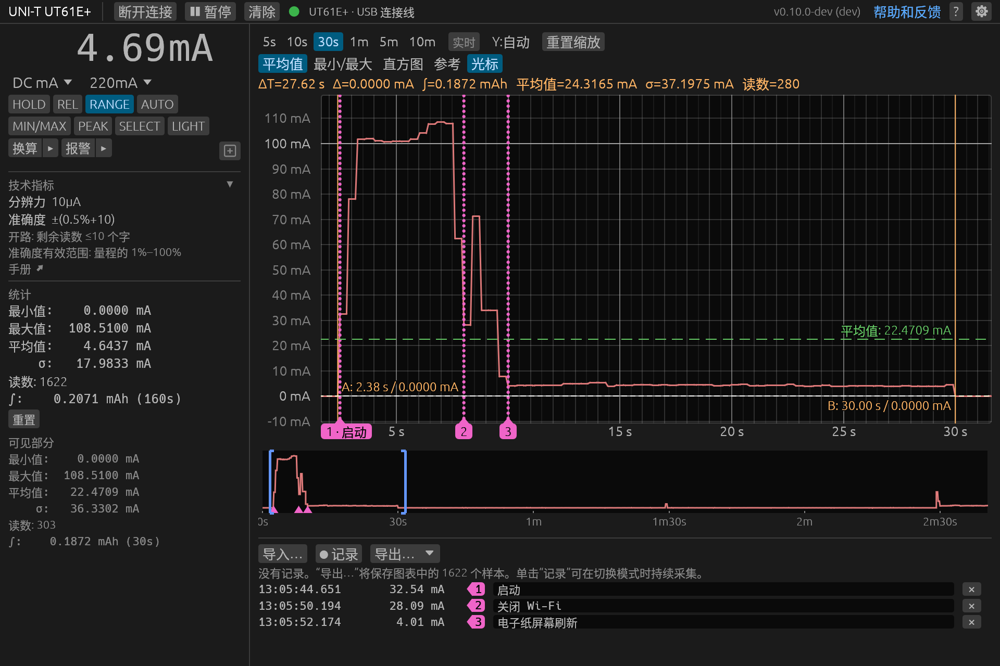

<!-- translated from README.md 5de2854e974370ecfc417d2bd201cb7398fd7b07 -->
# dmm-tools

[](https://github.com/antoinecellerier/dmm-tools/actions/workflows/ci.yml)
[](https://github.com/antoinecellerier/dmm-tools/releases/latest)
[](LICENSE)

[English](README.md) · [Español](README.es.md) · [Français](README.fr.md) · [Português (Brasil)](README.pt-BR.md) · [日本語](README.ja.md) · **简体中文**

*本页为机器翻译，内容以[英文 README](README.md) 为准。欢迎母语人士[帮助审校](CONTRIBUTING.md#translations)（英文）。*

一套开源的桌面应用和命令行工具，通过 USB 或蓝牙连接数字万用表（DMM）和钳形表，读取并记录读数、绘制图表、遥控仪表。支持 UNI-T、ZOTEK（ZOYI、ANENG、BSIDE）、OWON、Brymen（Minipa）、EEVblog 和 Voltcraft，可在 Linux、Windows、macOS 和 Raspberry Pi 上运行。

适用于 UNI-T UT61E+、UT181A、UT161、UT71、UT60BT 和 UT804，ANENG AN9002（ZOTEK ZT-300AB），Brymen BM869s，EEVblog 121GW，OWON OW18E 和 B41T+，Voltcraft VC-890，以及[更多型号](#支持的设备)。

**目录：** [功能](#功能) · [支持的设备](#支持的设备) · [快速入门](#快速入门) · [文档](#文档) · [反馈](#反馈) · [许可证](#许可证)



## 功能

桌面应用和命令行工具都能：

- 检测所连接的万用表
- 遥控万用表：切换模式和量程，操作万用表按键
- 将读数保存为 CSV、JSON 或回放文件，并可再次打开
- 统计最小值、最大值、平均值、标准差和时间积分
- 在读数超出限值时报警
- 在软件中换算读数：设置比例因子、偏移和单位标签
- 以英语、巴西葡萄牙语、法语、日语、简体中文或西班牙语显示界面文字，跟随系统语言

### 桌面应用（`dmm-gui`）

桌面应用还能：

- 显示实时读数，以及说明书中该量程的分辨力和准确度
- 实时绘制读数图表，提供光标、参考线、最小/最大包络线和直方图
- 长时间记录测量数据，可在任意读数处添加标记和备注
- 在大字显示模式下让读数占满窗口

[GUI 帮助](docs/gui-reference.md)（英文）：桌面应用的完整指南。

### 命令行工具（`dmm-cli`）

命令行工具还能：

- 将读数以文本、CSV 或 JSON 格式持续输出到终端、文件或其他程序
- 按名称列出和设置万用表的模式、量程和标志，便于脚本使用
- 运行引导式捕获，用于报告错误或验证新的万用表

<!-- snippet via=dcma-boot-refresh.replay
dmm-cli read --interval-ms 2500 --count 5
-->
```
$ dmm-cli read --interval-ms 2500 --count 5
0.00 mA
32.54 mA
100.96 mA
107.95 mA
4.01 mA

--- 5 个读数 | 最小值: 0.00 mA | 最大值: 107.95 mA | 平均值: 49.09 mA | σ: 52.13 mA
```
<!-- /snippet -->

[CLI 帮助](docs/cli-reference.md)（英文）：命令行工具的完整指南。

## 支持的设备

| 万用表 | USB | 蓝牙 | 议题 |
|---|---|---|---|
| UNI-T UT61E+ | ✅ 已验证 | ✅ 已验证（适配器） | — |
| UNI-T UT61B+ | ✅ 已验证 | 🧪 实验性（适配器） | [#19](https://github.com/antoinecellerier/dmm-tools/issues/19) |
| UNI-T UT161E | ✅ 已验证 | 🧪 实验性（适配器） | [#7](https://github.com/antoinecellerier/dmm-tools/issues/7) |
| UNI-T UT61D+, UT161B/D | 🧪 实验性 | 🧪 实验性（适配器） | [#7](https://github.com/antoinecellerier/dmm-tools/issues/7) |
| UNI-T UT804 | ✅ 已验证 | — | [#16](https://github.com/antoinecellerier/dmm-tools/issues/16) |
| UNI-T UT803 | 🧪 实验性 | — | [#15](https://github.com/antoinecellerier/dmm-tools/issues/15) |
| UNI-T UT181A | 🟡 部分验证 | 🧪 实验性（适配器） | [#5](https://github.com/antoinecellerier/dmm-tools/issues/5) |
| UNI-T UT171A/B/C | 🧪 实验性 | 🧪 实验性（适配器） | [#4](https://github.com/antoinecellerier/dmm-tools/issues/4) |
| UNI-T UT60BT | — | 🧪 实验性（内置） | [#26](https://github.com/antoinecellerier/dmm-tools/issues/26) |
| UNI-T UT202BT | — | 🧪 实验性（内置） | [#27](https://github.com/antoinecellerier/dmm-tools/issues/27) |
| UNI-T UT71A/B, UT71C/D/E | 🧪 实验性 | 🧪 实验性（适配器） | [#22](https://github.com/antoinecellerier/dmm-tools/issues/22) |
| UNI-T UT8802, UT8802N | 🧪 实验性 | — | [#12](https://github.com/antoinecellerier/dmm-tools/issues/12) |
| UNI-T UT8803, UT8803E | 🧪 实验性 | — | [#3](https://github.com/antoinecellerier/dmm-tools/issues/3) |
| OWON CMS061 (UNI-T UT217A) | — | ✅ 已验证（内置） | [#45](https://github.com/antoinecellerier/dmm-tools/issues/45) |
| OWON B33 | — | 🧪 实验性（内置） | [#41](https://github.com/antoinecellerier/dmm-tools/issues/41) |
| OWON B35T+ | — | 🧪 实验性（内置） | [#42](https://github.com/antoinecellerier/dmm-tools/issues/42) |
| OWON B41T+ | — | 🧪 实验性（内置） | [#43](https://github.com/antoinecellerier/dmm-tools/issues/43) |
| OWON CM2100B | — | 🧪 实验性（内置） | [#44](https://github.com/antoinecellerier/dmm-tools/issues/44) |
| OWON CMS101 (UNI-T UT217B) | — | 🧪 实验性（内置） | [#45](https://github.com/antoinecellerier/dmm-tools/issues/45) |
| OWON OW18B/OW16B | — | 🧪 实验性（内置） | [#39](https://github.com/antoinecellerier/dmm-tools/issues/39) |
| OWON OW18E | — | 🧪 实验性（内置） | [#40](https://github.com/antoinecellerier/dmm-tools/issues/40) |
| OWON OW65B | — | 🧪 实验性（内置） | [#46](https://github.com/antoinecellerier/dmm-tools/issues/46) |
| OWON OW67B (Voltcraft VC871) | — | 🧪 实验性（内置） | [#47](https://github.com/antoinecellerier/dmm-tools/issues/47) |
| OWON OW69B (Voltcraft VC891) | — | 🧪 实验性（内置） | [#48](https://github.com/antoinecellerier/dmm-tools/issues/48) |
| ZOTEK ZT-5B (ANENG V05B) | — | ✅ 已验证（内置） | [#31](https://github.com/antoinecellerier/dmm-tools/issues/31) |
| ZOTEK ZT-5BQ (ANENG ST207) | — | 🧪 实验性（内置） | [#30](https://github.com/antoinecellerier/dmm-tools/issues/30) |
| ZOTEK ZT-300AB (ANENG AN9002) | — | 🧪 实验性（内置） | [#28](https://github.com/antoinecellerier/dmm-tools/issues/28) |
| ZOTEK ZT-5566SE (ANENG AN999S) | — | 🧪 实验性（内置） | [#29](https://github.com/antoinecellerier/dmm-tools/issues/29) |
| Brymen BM525s (Minipa ET-2615A) | 🟡 部分验证 | — | [#36](https://github.com/antoinecellerier/dmm-tools/issues/36) |
| Brymen BM827s (Minipa ET-2517A) | 🟡 部分验证 | — | [#35](https://github.com/antoinecellerier/dmm-tools/issues/35) |
| Brymen BM521s | 🧪 实验性 | — | [#36](https://github.com/antoinecellerier/dmm-tools/issues/36) |
| Brymen BM829s/BM822s/BM821s | 🧪 实验性 | — | [#35](https://github.com/antoinecellerier/dmm-tools/issues/35) |
| Brymen BM869s/BM867s | 🧪 实验性 | — | [#34](https://github.com/antoinecellerier/dmm-tools/issues/34) |
| Brymen BM788BT/BM787BT | — | 🧪 实验性（内置） | [#33](https://github.com/antoinecellerier/dmm-tools/issues/33) |
| EEVblog 121GW | — | 🧪 实验性（内置） | [#32](https://github.com/antoinecellerier/dmm-tools/issues/32) |
| Voltcraft VC-880, VC650BT | 🧪 实验性 | — | [#13](https://github.com/antoinecellerier/dmm-tools/issues/13) |
| Voltcraft VC-890 | 🧪 实验性 | — | [#14](https://github.com/antoinecellerier/dmm-tools/issues/14) |
| Voltcraft VC915/VC925 PV | — | 🧪 实验性（内置） | [#49](https://github.com/antoinecellerier/dmm-tools/issues/49) |
| Voltcraft VC920/VC940/VC960 | 🧪 实验性 | — | [#23](https://github.com/antoinecellerier/dmm-tools/issues/23) |

✅ = 各模式和命令已在真实硬件上确认，仅剩少数局部检查。🟡 = 连接和主要模式已确认，仍有部分模式或命令尚未验证。🧪 = 基于对厂商软件的逆向分析实现，尚未通过该连接方式在真实硬件上测试。— = 不支持该连接方式。

蓝牙“适配器”指 UNI-T 的 UT-D07A/B 附加模块；“内置”则无需适配器。哪些功能可用、哪些不可用，请在对应型号的议题中反馈。

有关连接线、蓝牙适配器、需要开启的功能以及各型号的验证情况，请参阅[支持的设备](docs/supported-devices.md)（英文）。你的万用表不在列表中？请[提交议题](https://github.com/antoinecellerier/dmm-tools/issues/new)，写明型号和连接方式。

## 快速入门

1. 下载对应平台的[最新版本](https://github.com/antoinecellerier/dmm-tools/releases/latest)并解压。首次启动时，[Windows](docs/setup.md#windows-protected-your-pc) 和 [macOS](docs/setup.md#macos-wont-open-dmm-cli-or-dmm-gui) 会弹出安全警告（说明为英文）。
2. 授予工具访问连接线的权限，或打开蓝牙：
   - Linux：安装 udev 规则，然后重新插拔连接线。
     ```sh
     sudo cp udev/70-dmm-tools.rules /etc/udev/rules.d/ && sudo udevadm control --reload-rules
     ```
   - Windows：CP2110 连接线可能需要 [Silicon Labs 驱动程序](https://www.silabs.com/developers/usb-to-uart-bridge-vcp-drivers)；其他连接线无需额外驱动。
   - macOS：无需安装。
3. 打开万用表的数据传输，然后运行：
   ```sh
   dmm-cli read            # 持续读取测量值
   dmm-gui                 # 启动图形界面
   ```

[安装与故障排除](docs/setup.md)（英文）介绍驱动程序、udev 详情、无图形界面的计算机、从源码构建和开发版本。

## 文档

面向用户：

- [CLI 参考](docs/cli-reference.md)（英文）
- [GUI 参考](docs/gui-reference.md)（英文）
- [安装与故障排除](docs/setup.md)（英文）
- [支持的设备](docs/supported-devices.md)（英文）
- [更新日志](CHANGELOG.md)（英文）

面向贡献者：[CONTRIBUTING.md](CONTRIBUTING.md) 介绍错误报告、协议捕获和代码修改；另见[开发指南](docs/development.md)、[架构](docs/architecture.md)、[协议详情](docs/protocol.md)、[UX 设计](docs/ux-design.md)和[添加设备](docs/adding-devices.md)（均为英文）。

## 反馈

错误、想法、疑问，或应用和文档中让你困惑的地方：请[提交议题](https://github.com/antoinecellerier/dmm-tools/issues/new)。使用[设备表](#支持的设备)中的万用表时，请在该型号所在行的议题中反馈使用情况。[错误报告应包含哪些内容](CONTRIBUTING.md#bug-reports)（英文）。

## 许可证

GPL-3.0-or-later。详见 [LICENSE](LICENSE)。

## 致谢

感谢以下社区项目为本项目提供参考和交叉验证：

- [ljakob/unit_ut61eplus](https://github.com/ljakob/unit_ut61eplus) 和 [mwuertinger/ut61ep](https://github.com/mwuertinger/ut61ep)：UT61E+ 协议，分别用 Python 和 Go 实现
- [gulux/Uni-T-CP2110](https://github.com/gulux/Uni-T-CP2110)：UT171 捕获数据和解析器
- [antage/ut181a](https://github.com/antage/ut181a) 和 [libsigrok `uni-t-ut181a`](https://github.com/sigrokproject/libsigrok/tree/master/src/hardware/uni-t-ut181a)：UT181A 协议
- [pylablib](https://github.com/AlexShkarin/pyLabLib)：VC-880 的表格和标志
- [Silicon Labs AN434](https://www.silabs.com/documents/public/application-notes/an434-cp2110-4-interface-specification.pdf)：CP2110 HID 转 UART 规范；[UNI-T](https://meters.uni-trend.com/download/ut61b-d-e-user-manual/)：UT61+ 使用说明书
